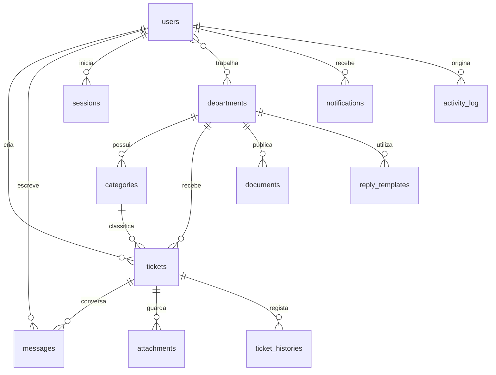

# Arquitetura da edição JavaScript

## Decisões de simplificação

A versão anterior usava Laravel, Livewire, Filament, Composer e MySQL. Esta versão usa um único servidor Node.js, HTML produzido no servidor, CSS responsivo e JavaScript simples no navegador. A persistência usa a biblioteca nativa `node:sqlite`.

**Benefícios:** um comando para iniciar, zero dependências npm, sem serviço de base de dados separado, ficheiros fáceis de localizar e baixo consumo de recursos. **Limite:** o SQLite síncrono e o servidor único não foram concebidos para várias instâncias com grande volume de pedidos simultâneos; num ambiente maior, separar a camada de dados e usar ferramentas mais maduras.

## Modelo simplificado de dados

Os perfis são um campo `role` validado na base de dados e nas rotas, em vez de tabelas de permissões externas. Todos os acessos aos pedidos verificam propriedade ou departamento. Os ficheiros ficam em `uploads/` e só podem ser descarregados por rotas com controlo de autorização.

## Segurança implementada

- Passwords com `scrypt` + salt individual.
- Sessões persistentes por token criptograficamente aleatório, com cookie HttpOnly/SameSite.
- CSRF nos formulários, validação de origem e consultas parametrizadas contra SQL injection.
- Escapamento de HTML e política de segurança de conteúdo restritiva.
- Restrições por perfil e departamento também no servidor.
- Upload com validação da assinatura binária, extensão e tamanho, nomes gerados aleatoriamente.
- Registo de actividades e tentativas limitadas por endereço IP.

**A implementar antes de produção:** revisão de segurança, antimalware, limites e monitorização distribuídos, entrega de emails, verificação de contas, políticas de retenção de dados, consentimentos e backups remotos encriptados.

## Expansão académica

Consulte `PORTAL_ACADEMICO.md` para o esquema de pré-inscrições, docentes, trabalhos, avaliações, inscrições e políticas respectivas.
