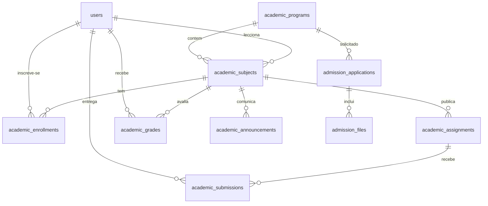

# Arquitectura do Portal Académico ISMMA

## Organização

A aplicação mantém as funções de atendimento e os módulos académicos sem frameworks, com PostgreSQL (Supabase) como base de dados.

| Ficheiro | Responsabilidade |
|---|---|
| `src/db.js` | Ligação PostgreSQL (`pg`), transacções, helpers de consulta, auditoria e notificações |
| `src/schema.js` | Esquema completo (28 tabelas), índices e catálogos institucionais idempotentes |
| `src/app.js` | Servidor de rotas de atendimento, autenticação e políticas existentes |
| `src/academic-routes.js` | Rotas de pré-inscrição e do portal académico, verificações de permissão |
| `src/views.js` | Layout geral, autenticação, atendimento e administração anterior |
| `src/academic-views.js` | Homepage, admissão, painéis, turmas, trabalhos, notas e administração académica |
| `public/app.css` | Estilo responsivo; CSS local e sem bibliotecas externas |
| `tests/academico.test.js` | Testes de admissão, funções académicas, segurança e permissões |

## Domínio académico

- `academic_programs`: cursos (nomes de licenciatura baseados no site público).
- `academic_subjects`: unidades curriculares, ano, semestre, docente, horário e sala.
- `academic_enrollments`: ligação entre estudantes e disciplinas, com estado de inscrição.
- `academic_assignments`: trabalhos, instruções e prazos de entrega.
- `academic_submissions`: entregas de texto e ficheiro privado.
- `academic_grades`: avaliações de 0 a 20 valores, incluindo rascunhos que só o docente vê.
- `academic_announcements`: comunicados por disciplina.
- `admission_applications`: pré-inscrições e os respectivos protocolos.
- `admission_files`: ficheiros de candidatura em armazenamento privado, acessíveis apenas ao administrador.

## Resumo ER

## Segurança e acesso

- **Administrador:** toda a gestão académica, análise de candidaturas e consulta dos seus anexos, além da gestão de atendimento.
- **Docente:** é uma conta institucional `funcionario` com `is_teacher=1`; só consegue aceder e alterar as disciplinas atribuídas por `academic_subjects.teacher_id`. Pode lançar notas não publicadas e publicá-las mais tarde.
- **Estudante:** só consulta disciplinas com `academic_enrollments.status='inscrito'`; vê as suas próprias entregas e notas `published=1`. Nunca vê trabalhos de colegas nem notas de rascunho.
- **Candidato:** só vê o estado das candidaturas associadas ao próprio email quando autenticado; a consulta pública exige protocolo e email e apresenta apenas o estado.
- **Sem autenticação:** portal institucional, cursos públicos, formulário de pré-inscrição e consulta limitada de protocolo. Não há acesso público a documentos enviados.
- Cada formulário POST usa `_csrf`; cada leitura/alteração sensível aplica validação no servidor e consultas parametrizadas.

## Nota sobre o modelo das avaliações

A média apresentada é **indicativa e simples**, sem ponderações ou efeitos sobre a classificação académica real. Exames, equivalências, recursos, frequência, aprovação e cálculo de médias finais precisam de validação junto do ISMMA e não estão implementados.

## Evolução para produção

Antes de integrar com estudantes reais, confirmar processos de admissão, registos de matrícula e identidade, regras de avaliação, código de estudante, autenticação institucional, autorização de docentes, privacidade dos dados, auditoria, políticas de retenção e integração com sistema oficial, caso exista. A base já é PostgreSQL multi-utilizador; resta validar a configuração de rede, backups e limites do plano Supabase.
